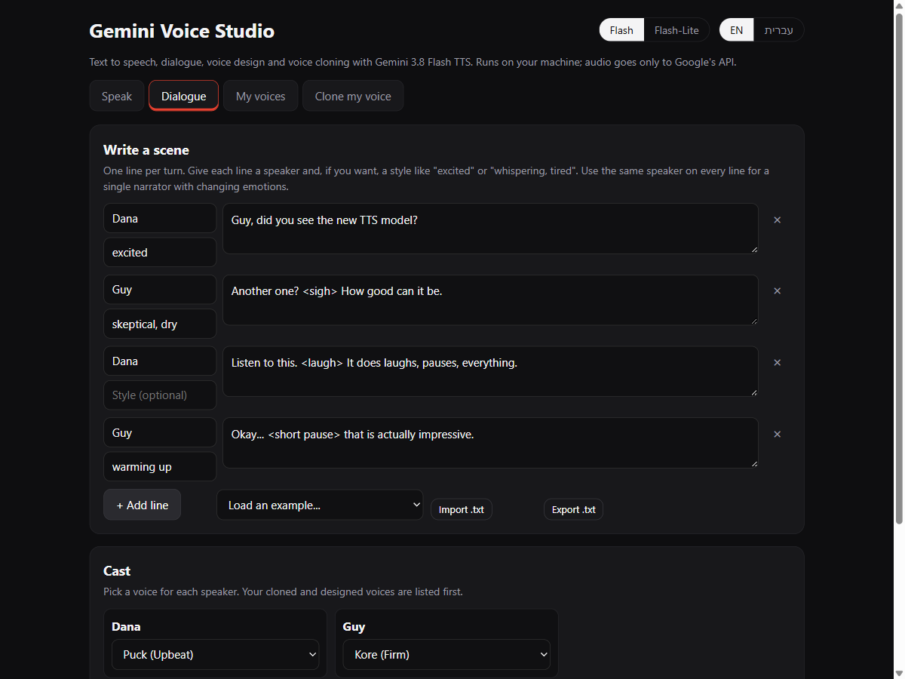

# gemini-tts — Gemini 3.8 Flash TTS for Claude Code (and your terminal)

Studio-grade text to speech with Google's **Gemini 3.8 Flash TTS**: natural narration in 130 languages (Hebrew included), multi-speaker dialogue with per-line emotion, inline laughs and pauses, **voice design** from a text description, and **cloning your own voice**. Comes with a friendly local web studio (English / עברית) and a CLI that does the same things without the UI.

Everything runs on your machine. Audio goes only to Google's API with your own key.



## Install in 2 minutes (global, works in every project)

The skill installs into your **home** skills folder, `~/.claude/skills/gemini-tts`, so it is available in every Claude Code project, not just one.

**Option A: one line.** Installs the skill, `requests`, ffmpeg if missing, asks for your key once, and runs the self-check.

```powershell
# Windows (PowerShell)
irm https://raw.githubusercontent.com/guyaga/gemini-tts-skill/main/install.ps1 | iex
```
```bash
# macOS / Linux
curl -fsSL https://raw.githubusercontent.com/guyaga/gemini-tts-skill/main/install.sh | bash
```

**Option B: let Claude do it.** Paste this into Claude Code:

> Install the gemini-tts skill globally: clone https://github.com/guyaga/gemini-tts-skill into ~/.claude/skills/gemini-tts (my home folder, not this project), pip install requests, make sure ffmpeg is on PATH, then run its doctor command and help me set GEMINI_API_KEY if it is missing.

**Option C: by hand.**

```bash
git clone https://github.com/guyaga/gemini-tts-skill ~/.claude/skills/gemini-tts
pip install requests
```

Updating later: `git -C ~/.claude/skills/gemini-tts pull` (or rerun the one-liner). Your voices and recordings are untouched by updates.

You also need **ffmpeg** on your PATH (`winget install Gyan.FFmpeg` on Windows, `brew install ffmpeg` on macOS, `sudo apt install ffmpeg` on Linux) and a free **Gemini API key** from https://aistudio.google.com/apikey:

```powershell
# Windows (persistent)
setx GEMINI_API_KEY "your-key"
```
```bash
# macOS / Linux (add to ~/.zshrc or ~/.bashrc)
export GEMINI_API_KEY="your-key"
```

Then check everything in one go:

```bash
python ~/.claude/skills/gemini-tts/scripts/gemini_tts.py doctor
```

## Enjoy it

### The studio (recommended for humans)

```bash
python ~/.claude/skills/gemini-tts/scripts/gemini_tts.py studio
```

Opens http://127.0.0.1:7891 with four tabs. Switch the interface language with the EN / עברית toggle at the top (full right-to-left layout in Hebrew).

| Tab | What you do there |
|---|---|
| **Speak** | Type text, pick a voice, describe the delivery ("warm, slow, like a bedtime story"), click tags to drop `<laugh>`, `<sigh>`, `<short pause>` at exact spots. Generate, listen, the file is saved to `outputs/`. |
| **Dialogue** | Write a scene line by line: speaker, optional style, text. Cast a voice per speaker. Same speaker on every line gives one narrator with changing emotions. Load built-in examples, import or export plain `.txt` scripts. |
| **My voices** | See the voices you designed or cloned, preview, delete. Design a new voice from a one-sentence description. |
| **Clone my voice** | Record the consent sentence, record (or upload) a 30-second sample, create, test. |

### In Claude Code

Just ask. "Narrate this script in Hebrew with a warm voice", "make a two-person dialogue about X", "clone my voice", "design a gravelly old sailor voice". The skill's `SKILL.md` teaches Claude the right prompting rules for this model.

### From the terminal

```bash
S=~/.claude/skills/gemini-tts/scripts/gemini_tts.py
python $S speak "Hey! <laugh> Welcome back. <short pause> Let's begin." --voice Sulafat --style "warm, upbeat" -o hello.mp3
python $S speak --file chapter1.txt --voice Charon --style "calm audiobook narrator" -o chapter1.wav   # long text is auto-chunked
python $S dialogue scene.txt --speakers "Dana=Leda,Guy=Orus" -o scene.wav
python $S prebuilt                      # the 30 studio voices
python $S voices --lang en-GB --gender female
python $S design --name "Old Sailor" --prompt "A gravelly Scottish sailor in his 70s, slow and amused." --gender male --alias sailor
python $S speak "Aye, the sea was angry that day." --voice sailor -o sailor.wav
```

`scene.txt` format, one turn per line, style in brackets is optional:

```
Dana [excited]: Guy, did you see the new TTS model?
Guy [skeptical, dry]: Another one? <sigh> How good can it be.
Dana: Listen to this. <laugh> It does laughs, pauses, everything.
```

## Writing for this model (the three rules)

1. **Text is a verbatim transcript.** Never write "Say cheerfully:" in the text; the model will read it out loud.
2. **Mood goes in style.** `--style "whispered urgently"`, or the Style box in the studio, or `[brackets]` in a dialogue line.
3. **Moments go in angle brackets, inline.** `<laugh> <chuckle> <sigh> <gasp> <breath> <cough> <yawn> <whispers> <short pause> <long pause>` and more. Human sounds only.

CAPITALS add emphasis, `...` and `--` add hesitation.

## Cloning your voice: what to know

- Google requires two clips from the **same real person**: a consent sentence (offered in 30 languages, English works for everyone) and a speech sample. Synthetic audio is rejected.
- **If your sample is in a different language than the consent** (for example a Hebrew sample with English consent), Google's speaker check fails with "Voice mismatch". The studio fixes this automatically by prepending your consent clip to the sample (`--prepend-consent` on the CLI). Keep the sample part to about 30 seconds.
- Stored voices live for one year and count toward 200 per project. Tick **Stateless** to get a 7-day key with nothing stored at Google.
- Your recordings, voice ids and outputs stay in the skill folder (`recordings/`, `voices.json`, `outputs/`) and are git-ignored.

## Models

| | `gemini-3.8-flash-tts` (default) | `gemini-3.8-flash-lite-tts` (`--lite` or the toggle) |
|---|---|---|
| Best for | narration, acting, dialogue, accents | volume, speed, cost |
| Languages | 130 | 101 |

## Requirements

Python 3.9+, `requests`, ffmpeg. Tested on Windows 11 with Python 3.13; the code is plain standard library plus `requests` and should behave the same on macOS and Linux.

## License

MIT. Gemini and the TTS models are Google's; use of cloned voices is subject to Google's terms and to the consent of the person whose voice it is.
